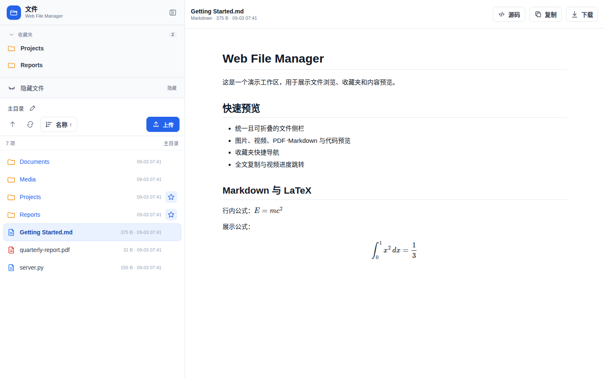

# Web File Manager

[English](README.md) | 简体中文

轻量级单用户网页文件浏览器。界面根目录固定为运行用户的 `$HOME`，支持文件预览、收藏夹、上传和下载。

## 界面

<p align="center">
  
</p>

## 功能

- 左侧为收藏夹和文件列表，右侧为预览区。
- 默认深色（Darcula）。侧栏底部的「主题」菜单可在 13 个主题之间切换（6 个深色、7 个浅色，含 Cloud Light）；每个浏览器各自记住选择，选「默认」则回到服务器的 `WEBFM_THEME`。代码高亮随主题切换。
- 文件侧栏可调整宽度，也可通过按钮或 `B` 键整体收起。
- 收藏夹默认折叠；目录行的星标用于添加或取消收藏。
- 隐藏文件开关使用闭眼和睁眼图标表示当前状态。
- 路径栏支持粘贴 `$HOME` 或额外根目录（如 `/tmp`）内的绝对路径，也支持 `/?open=<path>` 深链接。
- 图片支持预览和同目录左右切换。图片可以在预览区里缩放：触屏上双指捏合缩放（放大后单指拖动，双击在该处放大或恢复原样），用鼠标时双击、拖动，触控板上双指捏合。切换到下一张图片时恢复原始大小。
- 视频使用浏览器原生播放器，默认静音，支持拖动进度和 `←` / `→` 后退或前进 5 秒。可播放的编码取决于浏览器。
- PDF 使用本地 PDF.js 查看器打开。
- Markdown 支持语法高亮和 `$...$`、`$$...$$`、`\(...\)`、`\[...\]` LaTeX 公式。
- HTML 文件支持网页预览和源码切换；文本与代码文件支持语法高亮。
- Markdown、HTML、文本和代码预览提供“复制”操作，可复制包括预览上限之外内容在内的完整源文。
- 正在预览的文件在磁盘上改动后会自动重新加载：图片、PDF、视频、Markdown、HTML、文本和代码都支持。重新加载会保留你看到的位置（PDF 的页码和缩放、滚动位置、视频的播放时间、Markdown 的渲染或源码视图），并短暂显示“已更新”。还在写入中的文件，等它停止变化片刻后再显示；被删除的文件保留在屏幕上并标出“文件已删除”，文件回来后会自动重新加载。只在页面可见时检查。
- 支持拖放上传、多文件上传和文件下载。
- 窄屏下文件列表和预览区分别显示，预览页提供返回列表按钮。

## 运行

依赖 Python 3.8+ 和 Tornado 6.x。

```bash
WEBFM_AUTH="<user>:<strong-password>" python web_file_manager.py
```

默认监听 `0.0.0.0:7701`。

| 变量 | 默认值 | 说明 |
|---|---|---|
| `WEBFM_AUTH` | 必填 | HTTP Basic 凭证，格式为 `user:pass` |
| `WEBFM_PORT` | `7701` | 监听端口 |
| `WEBFM_BIND` | `0.0.0.0` | 逗号分隔的监听地址 |
| `WEBFM_CONFIG_DIR` | `~/.config/web-file-manager` | 配置目录 |
| `WEBFM_FAVORITES_FILE` | `$WEBFM_CONFIG_DIR/favorites.json` | 收藏夹数据文件 |
| `WEBFM_EXTRA_ROOTS` | `/tmp` | 逗号分隔、可只读浏览的 `$HOME` 之外的目录；设为空即关闭 |
| `WEBFM_THEME` | `darcula` | 浏览器在主题菜单里选择之前显示的主题：`darcula`、`dracula`、`one-dark`、`nord`、`gruvbox-dark`、`catppuccin-mocha`、`cloud-light`、`github-light`、`one-light`、`solarized-light`、`gruvbox-light`、`catppuccin-latte` 或 `nord-light`。无法识别的值回退到 `darcula` 并给出警告 |

## systemd 用户服务

`~/.config/systemd/user/webfilemanager.service`：

```ini
[Unit]
Description=Web File Manager
After=network.target

[Service]
Type=simple
Environment="WEBFM_AUTH=<user>:<strong-password>"
Environment=WEBFM_PORT=7701
WorkingDirectory=%h
ExecStart=/path/to/python /path/to/web-file-manager/web_file_manager.py
Restart=on-failure
RestartSec=3

[Install]
WantedBy=default.target
```

```bash
systemctl --user daemon-reload
systemctl --user enable --now webfilemanager.service
```

## 运行边界

- 未设置 `WEBFM_AUTH` 时服务拒绝启动。
- 界面只能访问 `$HOME` 和 `WEBFM_EXTRA_ROOTS` 目录中的内容；越界路径和指向它们之外的符号链接返回 403。
- 额外目录是只读的：向其中上传返回 403。每个额外目录在路径栏里是独立的根，所以 `/tmp` 与 `~/tmp` 互不混淆，`/?open=/tmp/...` 链接打开的是 `/tmp` 里的文件。
- HTML 预览按可信个人文档处理，不使用 iframe sandbox。
- 服务适合在可信 LAN 或 Nebula、Tailscale 等私有组网中使用，不应直接暴露在公网。

## 许可证

[MIT](LICENSE) © 2026 BoZhen。内置的 PDF.js（`pdfjs/`）和 MathJax（`mathjax/`）使用 Apache License 2.0，许可证文件在各自目录中。
